<div align="center">

# My Shell

**A minimal settings window and status bar for Hyprland, built with [Quickshell](https://quickshell.org).**

Colors and fonts come from one `~/.config/kuro/kuro.toml` · 10 pages · 3 sharp bar layouts · Quickshell notifications and lock screen


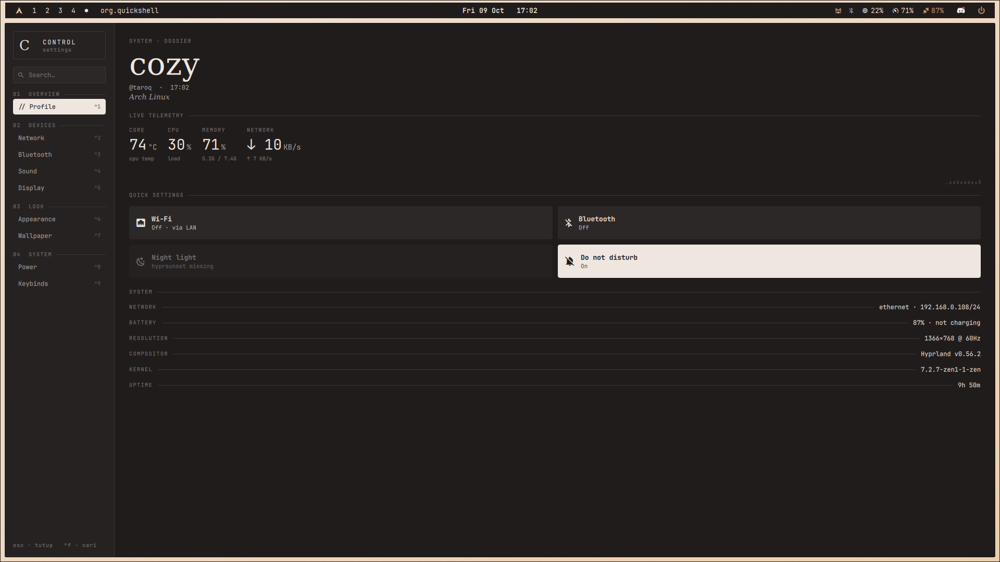

</div>

---

## What is this

My personal desktop shell for Hyprland. It started as a small control center and grew into two things that live in the same Quickshell config:

- **Control Center**, a regular app window (not a panel) with a sidebar and pages for network, sound, display, wallpaper, clipboard and so on.
- **Bar**, a status bar that replaces Waybar. It has three sharp layouts: Full, Float, and Island.

Everything reads its colors, fonts and visual settings from one central file: `~/.config/kuro/kuro.toml`. Hyprland, kitty and this shell are all generated from it by `bin/kurogen`, so terminal and shell always match. Set `Config.usePywal = true` to let pywal override the palette at runtime.

---

## Preview

<table>
  <tr>
    <td width="50%">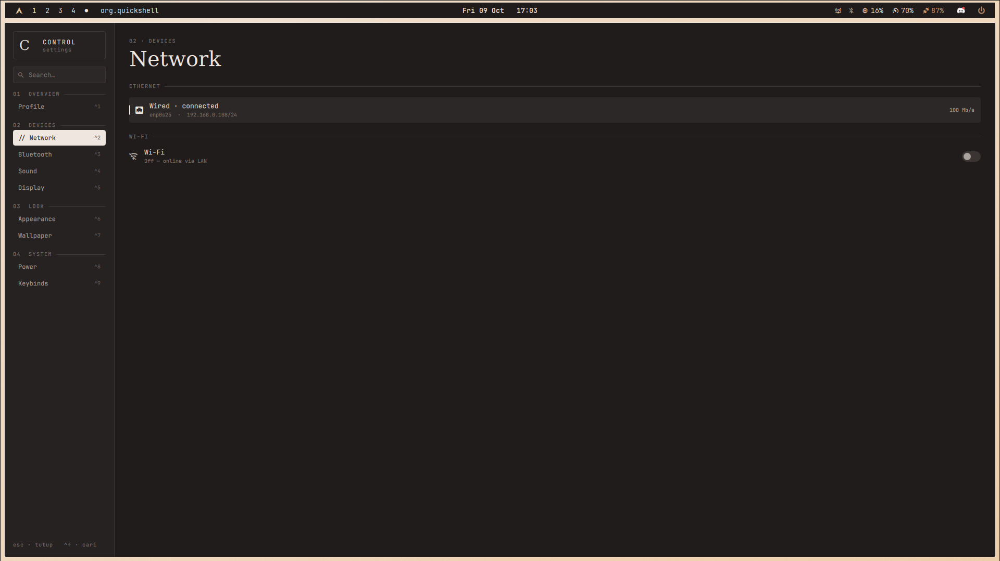<br><sub><b>Network</b> — Ethernet, Wi-Fi, scan and connect</sub></td>
    <td width="50%">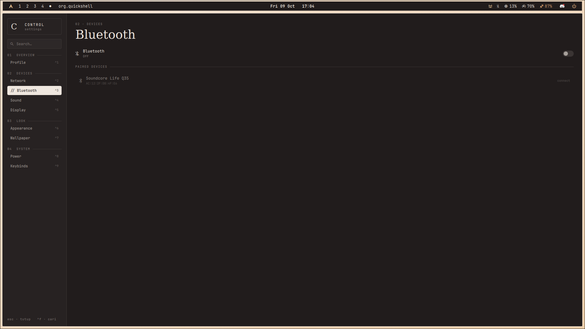<br><sub><b>Bluetooth</b> — paired devices</sub></td>
  </tr>
  <tr>
    <td>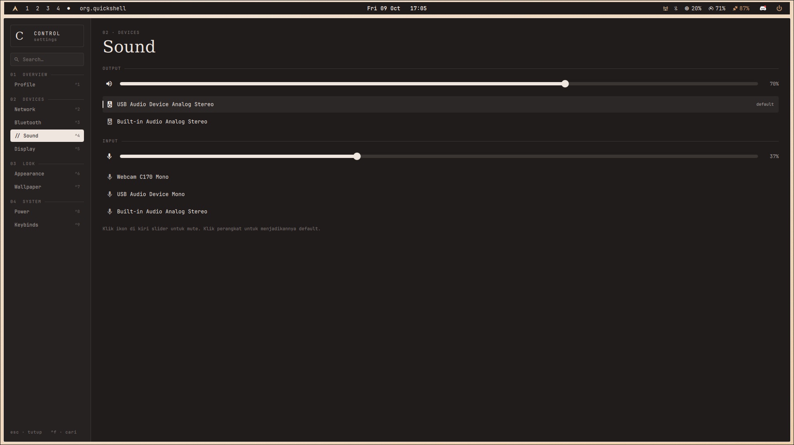<br><sub><b>Sound</b> — volume, mic, output and input</sub></td>
    <td>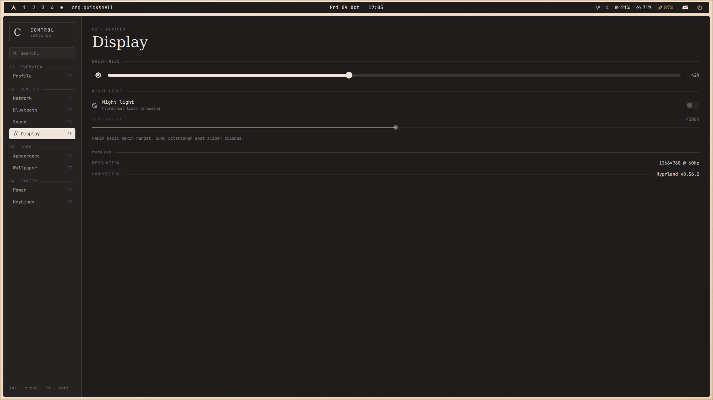<br><sub><b>Display</b> — brightness and night light</sub></td>
  </tr>
  <tr>
    <td>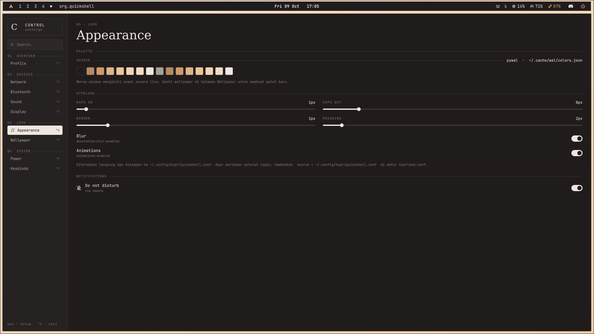<br><sub><b>Appearance</b> — pywal palette, bar layouts, Hyprland options</sub></td>
    <td>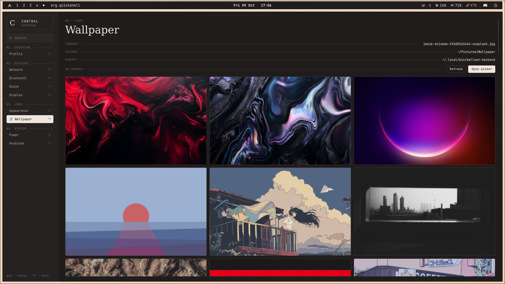<br><sub><b>Wallpaper</b> — thumbnail grid</sub></td>
  </tr>
  <tr>
    <td>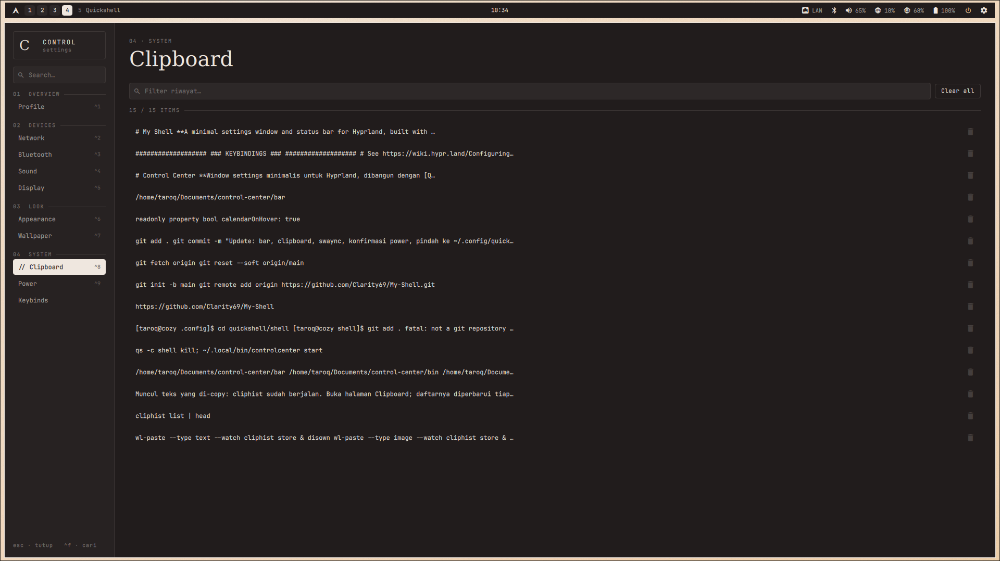<br><sub><b>Clipboard</b> — text and image history</sub></td>
    <td>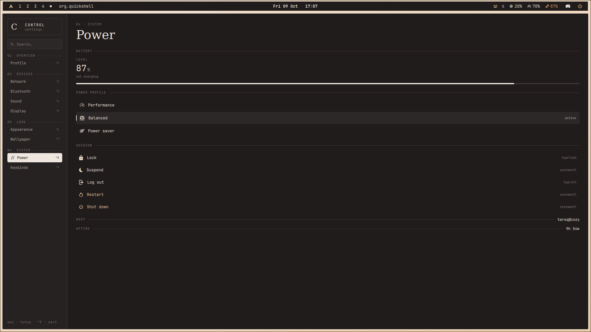<br><sub><b>Power</b> — battery, power profile, session</sub></td>
  </tr>
  <tr>
    <td>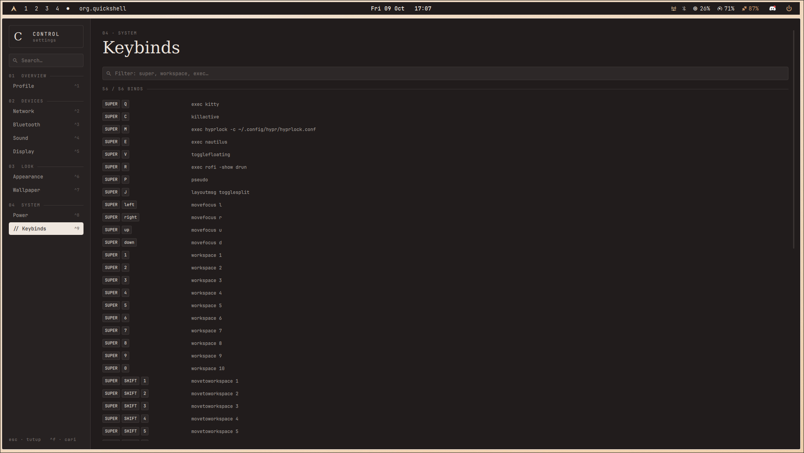<br><sub><b>Keybinds</b> — every active bind, filterable</sub></td>
    <td>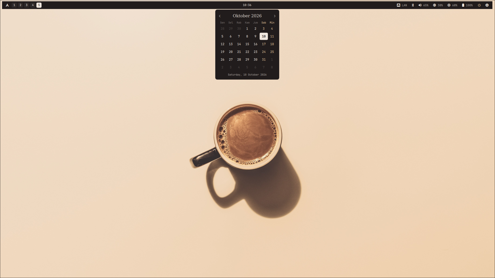<br><sub><b>Bar calendar</b> — hover or right-click the clock</sub></td>
  </tr>
</table>

<details>
<summary><b>Bar layouts</b></summary>
<br>
All layouts use sharp corners:

- **Full** — full-width bar based on the Omarchy layout.
- **Float** — inset bar with space around its edges.
- **Island** — separate left and right groups, with the dynamic island centered.

</details>

---

## Features

### Control Center

| Page | What it does | Backend |
|---|---|---|
| **Profile** | hostname, live telemetry (temp, CPU, RAM, network), quick toggles, system info | `/proc`, `/sys` |
| **Network** | Ethernet status (IP, link speed), Wi-Fi on/off, scan, connect and disconnect | `nmcli` |
| **Bluetooth** | power, paired devices, connect and disconnect | `bluetoothctl` |
| **Sound** | volume and mic, pick default output and input | `wpctl` |
| **Display** | brightness, night light with color temperature, monitor info | `brightnessctl`, `hyprsunset` |
| **Appearance** | pywal palette, bar layout picker, gaps / border / rounding / blur / animations, notifications | `hyprctl`, Quickshell |
| **Wallpaper** | built-in thumbnail picker using the running awww daemon | `awww` |
| **Clipboard** | text and image history with thumbnails, filter, copy again, delete | `cliphist`, `wl-clipboard` |
| **Power** | battery, power profile, lock / suspend / log out / restart / shut down | `upower`, `powerprofilesctl` |
| **Keybinds** | every active Hyprland bind, filterable | `hyprctl binds` |

Log out, Restart and Shut down need a second click within 5 seconds, so a stray click won't take the machine down.

### Bar

- One bar per monitor, with workspaces (numbers, kanji or roman numerals), active app, clock, tray, network, bluetooth, volume, mic, brightness, battery, CPU, memory, power profile, notifications and clipboard.
- Three sharp layouts: `full` (full-width), `float` (inset), and `island` (separate left, center, and right groups).
- Every indicator opens the matching Control Center page on click. Volume, mic and brightness react to scroll.
- The clock shows a small calendar on hover or right-click.
- The Quickshell lock screen uses the current wallpaper with a blurred backdrop and PAM password entry; `hypridle` locks after five idle minutes and before suspend.
- Press `Print` to freeze the focused monitor and open the sharp-edged screenshot and recording overlay. The clock opens its calendar only.
- Calendar tasks are stored as Markdown in `~/.config/kuro/task.md`.
- Quickshell owns notifications and history. Left click opens the notification center, right click toggles Do Not Disturb, middle click clears everything.
- The last picked layout is remembered across logins.

### Shortcuts inside the window

| Key | Action |
|---|---|
| `Ctrl` + `1`…`9` | jump to a page |
| `Ctrl` + `F` | search settings |
| `Esc` | clear search, or close the window |

### Desktop shortcuts

- Double left-click an empty desktop area to open the wallpaper picker.
- Double right-click an empty desktop area to open the theme picker.

---

## Layout

```
shell/
├── shell.qml               entry point: ShellRoot, Bar, Launcher, IPC handlers
├── ControlCenter.qml       the window: page list, sidebar, StackLayout
├── config/
│   ├── Config.qml          paths, commands, kuro paths (theme.json)
│   ├── Theme.qml           reads ~/.cache/kuro/theme.json
│   └── Icons.qml           Nerd Font glyphs
├── components/             pure UI, never runs commands
├── pages/                  one file per Control Center page
├── launcher/
│   └── LauncherWindow.qml  minimal nested-menu launcher overlay
├── services/
│   ├── Kuro.qml            watches kuro.toml and regenerates configs
│   ├── Launcher.qml        launcher engine
│   ├── LauncherSections.qml  launcher catalogue (including Style/themes)
│   └── ...                 one singleton per data source or CLI tool
├── bar/
│   ├── BarState.qml        layout definitions and the active layout
│   ├── Module.qml          every bar module and its click actions
│   └── ...                 Workspaces, Tray, ClockItem, CalendarPopup
├── bin/
│   ├── kurogen             kuro.toml -> theme.json, kuro.lua, kuro.conf, Helix theme
│   ├── fzpac               vendored fzpac TUI
│   ├── controlcenter       launcher: toggle / open / start
│   └── bar-layout          rofi picker for bar layouts
├── screenshots/
└── hyprland.conf.snippet
```

The rule I try to keep: `components/` never runs a shell command and `services/` never draws anything. Polling only runs for the page that is actually open.

---

## Dependencies

**Required:** `quickshell`, `networkmanager`, `bluez` and `bluez-utils`, `wireplumber`, `JetBrainsMono Nerd Font` (`ttf-jetbrains-mono-nerd`) for all UI text and icon glyphs. Install `hypridle` for automatic idle locking and display power management.

**Optional.** Anything missing just hides or disables its feature: `brightnessctl`, `hyprsunset`, `awww`, `python-pywal`, `cliphist`, `wl-clipboard`, `grim`, `slurp`, `hyprpicker`, `gpu-screen-recorder`, `jq`, `upower`, `power-profiles-daemon`, `libnotify`, `rofi`, `noto-fonts-cjk` for the kanji workspaces.

```sh
sudo pacman -S --needed quickshell networkmanager bluez bluez-utils wireplumber \
    brightnessctl hyprsunset upower power-profiles-daemon hypridle cliphist wl-clipboard \
    ttf-jetbrains-mono-nerd noto-fonts-cjk
```

---

## Install

```sh
git clone https://github.com/Clarity69/My-Shell.git ~/.config/quickshell/shell

ln -sf ~/.config/quickshell/shell/bin/controlcenter ~/.local/bin/controlcenter
ln -sf ~/.config/quickshell/shell/bin/bar-layout    ~/.local/bin/bar-layout
chmod +x ~/.config/quickshell/shell/bin/*

controlcenter start      # bar shows up, the window stays hidden
controlcenter            # open the window
```

While hacking on it, run it in the foreground so errors show up in the terminal:

```sh
qs -c shell kill; qs -c shell
```

Then open `config/Config.qml` and point the paths at your own setup. The defaults are mine.

### Hyprland

Hyprland loads the generated Kuro module at the top of `~/.config/hypr/hyprland.lua`. Hand-written settings are grouped into focused modules in `~/.config/hypr/conf.d/`:

```lua
pcall(require, "kuro")

local terminal    = (kuro and kuro.apps and kuro.apps.terminal) or "kitty"
local fileManager = (kuro and kuro.apps and kuro.apps.fileManager) or "dolphin"
local menu        = (kuro and kuro.apps and kuro.apps.menu) or "qs -c shell ipc call launcher toggle"
```

`kurogen` writes `~/.config/hypr/kuro.lua` from `kuro.toml` (colors, gaps, rounding, blur, input layout), `~/.config/kitty/kuro.conf` for kitty, and `~/.config/helix/themes/kuro.toml` for Helix. The Helix theme follows the active Kuro palette. `kitty.conf` only needs:

```conf
include ~/.config/kitty/kuro.conf
```

Autostart the shell from `hyprland.lua`:

```lua
hl.on("hyprland.start", function()
    hl.exec_cmd(home .. "/.local/bin/controlcenter start")
end)
```

The window rules for the floating Control Center and the fzpac TUI live in `hyprland.lua` as well.

### Keybinds I use

```lua
hl.bind("SUPER + space",          hl.dsp.exec_cmd("qs -c shell ipc call launcher toggle"))
hl.bind("SUPER + SHIFT + Return", hl.dsp.exec_cmd("kitty"))
hl.bind("SUPER + A",              hl.dsp.exec_cmd(controlcenter))
hl.bind("SUPER + V",              hl.dsp.exec_cmd(controlcenter .. " open clipboard"))
hl.bind("SUPER + TAB", function() hl.plugin.overview.toggle() end)
hl.bind("SUPER + N",              hl.dsp.exec_cmd("qs -c shell ipc call notifications toggle"))
hl.bind("SUPER + B",              hl.dsp.exec_cmd(barLayout))
hl.bind("SUPER + Q",              hl.dsp.window.close())
```

---

## Launcher

The bar's launcher button and `SUPER + space` open a minimal nested-menu launcher (no card grid):

- Root menu: `01 Apps`, `02 Setup`, `03 Containers`, `04 Packages`, `05 System`, `06 Appearance`, `07 Style`.
- Type to search globally, or press Enter on a category to drill in.
- `Esc` / `←` goes back; `Esc` on the root closes the launcher.
- Dangerous actions ask for a second Enter.
- Prefixes still work: `:clip`, `:wall`, `:file`, `:win`, `> command`, `? query`.
- Hover a row to see its description in a tooltip, so rows stay one line.

The Style section lists each colorscheme and the related wallpaper and font actions.

Package actions use the vendored `bin/fzpac` inside a floating, centered kitty window (class `omarchy-launcher-tui`) that closes when the TUI exits.

---

## Bar layouts

Switch from the Appearance page, from rofi, or from a terminal:

```sh
bar-layout            # rofi menu
bar-layout float      # jump straight to one
bar-layout next       # cycle
```

Layouts live in `bar/BarState.qml`. Adding one is a single entry:

```qml
"my-layout": {
    style: "islands", height: 30, radius: 10, margin: { top: 6, left: 10, right: 10 },
    left:   ["workspaces:kanji", "window:app"],
    center: ["datetime"],
    right:  ["tray", "notification", "volume", "battery", "control"]
},
```

Available modules: `workspaces` (`:kanji`, `:roman`), `window` (`:app` for the app name only), `clock`, `date`, `datetime`, `launcher`, `network`, `bluetooth`, `volume`, `mic`, `brightness`, `battery`, `cpu`, `memory`, `profile`, `notification`, `clipboard`, `tray`, `control`.

Click actions for each module are in `bar/Module.qml`. Every module has `onClicked`, `onRightClicked`, `onMiddleClicked` and `onScrolled`, so changing what a click does is a one-line edit.

---

## IPC

```sh
qs -c shell ipc call controlcenter toggle
qs -c shell ipc call controlcenter open <page>
qs -c shell ipc call bar toggle
qs -c shell ipc call bar layout <name>
qs -c shell ipc call bar next
qs -c shell ipc call dock setMode autohide
qs -c shell ipc call dock state

qs -c shell ipc call launcher toggle
qs -c shell ipc call launcher open
qs -c shell ipc call launcher enter <section>
qs -c shell ipc call launcher back
qs -c shell ipc call launcher state
```

Dock mode can be `enabled`, `disabled`, or `autohide`; the choice is saved across logins.

Pages: `profile` `network` `bluetooth` `sound` `display` `appearance` `wallpaper` `clipboard` `power` `keybinds`

---

## Config

All colors, fonts and visual settings live in `~/.config/kuro/kuro.toml`:

```toml
[theme]
scheme = "jellybeans"     # file name in ~/.config/kuro/themes/
rounding = 0
gaps_in = 4
gaps_out = 8
border_size = 2
blur = true

[fonts]
ui_family = "JetBrainsMono Nerd Font"
ui_size = 15
terminal_family = "JetBrainsMono Nerd Font"
terminal_size = 11.5

[apps]
terminal = "kitty"
file_manager = "dolphin"
wallpaper_dir = "~/Pictures/Wallpaper"
```

Each colorscheme is a standalone TOML in `~/.config/kuro/themes/` (Omarchy `colors.toml` format). Shipped themes: Jellybeans, Tokyo Night, Kanagawa, Catppuccin, Everforest, Rosé Pine, Gruvbox, Nord, Miasma, Solitude and Matte Black.

```sh
kurogen                 # regenerate desktop colors and the Helix theme
kurogen themes          # list colorschemes (* = active)
kurogen scheme nord     # switch colorscheme
kurogen set theme.gaps_in 8
```

The shell watches `kuro.toml`: saving it (or running `kurogen set`) regenerates everything, reloads Hyprland and sends kitty `SIGUSR1`. The Appearance page's buttons write back to `kuro.toml` through `kurogen set`.

Paths and external commands are in `config/Config.qml`:

| Option | Default | Notes |
|---|---|---|
| `usePywal` | `false` | `true` = follow pywal colors instead of the built-in palette |
| `walColors` | `~/.cache/wal/colors.json` | watched by Theme when `usePywal` is on |
| `wallpaperDir` | `~/Pictures/Wallpaper` | overridden by `[apps].wallpaper_dir` |
| `wallpaperSet` | `awww img --transition-type grow --transition-pos center --transition-duration 1.1 --transition-fps 60 "$1"` | reveals the selected image with a centered, 1.1-second grow transition |
| `wallpaperPicker` | `qs -c shell ipc call stylepicker wallpaper` | opens the built-in wallpaper picker; overridden by `[apps].wallpaper_picker` |
| `wallpaperLog` | `~/.cache/wallset-backend.log` | backend output goes here |
| `clipLimit` | `80` | how many clipboard entries to show |
| `terminal` | `["kitty", "-e"]` | overridden by `[apps].terminal` |
| `kuroConfig` | `~/.config/kuro/kuro.toml` | source of truth for colors, fonts and look |
| `kuroTheme` | `~/.cache/kuro/theme.json` | generated for the shell |
| `nightLightDefault` | `4500` | starting night light temperature in K |
| `barEnabled` | `true` | show the bar on start |
| `barLayout` | `full` | layout used until you pick one |
| `calendarOnHover` | `true` | set to `false` to open the calendar on right-click only |
| `launcherCommand` | `rofi -show drun` | what the launcher module runs |

Colors, fonts and look come from `kuro.toml`; `config/Theme.qml` only loads the generated `~/.cache/kuro/theme.json` (with built-in fallbacks).

---

## Taking screenshots

The images above are read from `screenshots/`. Open a page, focus the window, then:

```sh
cd ~/.config/quickshell/shell/screenshots
controlcenter open network
sleep 2 && grim -g "$(hyprctl activewindow -j | jq -r '"\(.at[0]),\(.at[1]) \(.size[0])x\(.size[1])"')" Network.png
```

`hyprshot -m window -o . -f Network.png` works too.

---

## Notes

- Your wallpaper script no longer needs to restart Waybar. Colors come from `kuro.toml` (or pywal if `Config.usePywal = true`), and the bar reloads when `theme.json` changes.
- Quickshell provides the notification center and PAM-backed lock screen; `hypridle` provides idle timeouts and locks before suspend.
- Saved Wi-Fi networks are matched by the SSID stored in NetworkManager. New locked networks ask for a password right in the list.
- The Appearance page applies changes immediately with `hyprctl eval` and persists them to `kuro.toml`. `kurogen` then regenerates `~/.config/hypr/kuro.lua`, which `hyprland.lua` loads with `require("kuro")`.
- This setup uses Hyprland's Lua config (`hyprland.lua`). The old `hyprland.conf` snippets in the repo are kept for reference only.
